<p align="center">
  
</p>

<p align="center">
  <b>Halocline: the engine that hides nothing.</b><br>
  The Qwen4 family on one NVIDIA Ada GPU (sm_89), a 24 GB RTX 4090. Each result names the run directory that
  produced it.
</p>

<p align="center">
  <code>status: pre-alpha</code> &nbsp; <code>target: sm_89 only</code> &nbsp; <code>models: Qwen4 family</code> &nbsp; <code>licence: MIT</code>
</p>


> [!IMPORTANT]
> **Halocline is for sm_89 (Ada) only, and it is tuned for one machine: [mine](SPECS.md).** The build refuses any compute
> capability except 8.9, and that will not change. It runs the Qwen4 family only. Its speeds and settings come from that
> one machine, so to reproduce them you need the same parts. On another Ada card it builds, and every number has to be
> measured again.
>
> To build an engine like this for your own card, read [the recipe](RESEARCH.md): the steps, the gates, the papers
> behind each decision, and how to fork Halocline and swap in kernels for your architecture.

A halocline is the layer in deep water where salinity changes so sharply that the water above and below barely mix.
This repository works on one such boundary: the distance between what Qwen3.8-Flash-Next says at BF16 and what it says
from 4-bit weights, an int8 KV cache and a draft layer, on a single 24 GB card.

## The question

Qwen3.8-Flash-Next holds [125B parameters with 6B active](https://huggingface.co/Qwen/Qwen3.8-Flash-Next), plus a 51B
n-gram embedding table and a 4B MTP draft layer. At BF16 it does not fit one 24 GB card. Halocline serves it from
[Unsloth's UD-IQ4_XS GGUF](https://huggingface.co/unsloth/Qwen3.8-Flash-Next-GGUF): 93,672,359,738 bytes of weights,
18.2 GiB of experts in VRAM and 38.0 to 41.3 GiB page-locked in RAM, 262,144 tokens of context.

Each step away from BF16 carries a measurement:

| Step | Who sets it | What the repo measures |
|---|---|---|
| Expert and dense weights, UD-IQ4_XS | Unsloth's quant, copied byte for byte | mean KLD, top-1 and PPL against BF16 (`evals/2026-11-17/halocline-kv-kld/`) |
| KV cache format | Halocline, `--kv` | paired per-chunk dKLD with a 95% interval, prefill at 32K and 131K (same directory) |
| Draft layer | Halocline, `--spec` | decode speed by prompt type and tokens accepted per pass (`evals/2026-11-17/halocline-kv-kld/`) |
| Expert placement | Halocline, from the VRAM budget | greedy identity across builds (`evals/2026-11-17/halocline-greedy-identity/`) |

## The reference

One frozen BF16 file anchors every quality number:

| Item | Value |
|---|---|
| Model | [Qwen3.8-Flash-Next](https://huggingface.co/Qwen/Qwen3.8-Flash-Next/tree/de4b8e4d43b917e7706784d8bb445c9af86a3540), revision `de4b8e4d`: 48 layers, 512 experts (10 routed plus 1 shared), Gated DeltaNet and Qwen Sparse Attention, 262,144 native context |
| BF16 weights | [Unsloth BF16 GGUF](https://huggingface.co/unsloth/Qwen3.8-Flash-Next-GGUF/tree/main/BF16), `Qwen3.8-Flash-Next-BF16-0000*-of-00008.gguf`; the base file's sha256 pins the score, not the repo revision |
| Base file | `flashnext-bf16-base.kld`, 12,664,728,820 bytes, sha256 `c4e0221632607324d314556b8813d772867c300454ecdea37f1bf9d5555cf1a9` |
| Made by | `llama-perplexity --kl-divergence-base`, llama.cpp `436f6f89e`, wikitext-2 `wiki.test.raw`, 100 chunks of 512 tokens, `-b 8192 -ub 8192`, base PPL 3.2749 (3.2733 on the scored rows) |
| Hosted at | [jesdga/basalt-kld-bases](https://huggingface.co/datasets/jesdga/basalt-kld-bases/tree/a65bae55f703e9c6dab6e9f335146c532fb7dd95), checksums in `SHA256SUMS` |
| Reported | mean, median and p99 KLD, top-1 agreement, PPL, and a paired per-chunk difference with a 95% t interval |

The base stores the tokens and the full-vocabulary log-probabilities of every scored position. It is never regenerated;
each numerics change is scored against the same bytes.

## Results

Qwen3.8-Flash-Next UD-IQ4_XS v3.1 with the MTP drafter, `--kv int8 --spec 8`, on the [reference machine](SPECS.md).
The quality and draft-window tables are [`evals/2026-11-17/halocline-kv-kld/`](evals/2026-11-17/halocline-kv-kld/); the speed
table is [`halocline-llama-swap`](evals/2026-11-17/halocline-llama-swap/) against the Strata column of
[`halocline-p0-floors`](evals/2026-11-16/halocline-p0-floors/); identity is
[`halocline-greedy-identity`](evals/2026-11-17/halocline-greedy-identity/).

### Quality against BF16

| KV | PPL | mean KLD | top-1 | paired dKLD vs int8 [95% CI] | prefill 131K |
|---|---|---|---|---|---|
| **int8** | 3.2323 | **0.08195** | **90.45%** | reference | **6,019 t/s** |
| fp16 | 3.2320 | 0.08230 | 90.33% | +0.00035 [-0.00061, +0.00131] | 2,997 t/s |
| k8v4 | 3.2424 | 0.08621 | 90.26% | +0.00426 [+0.00307, +0.00545] | 5,694 t/s |
| q4_0 | 3.2399 | 0.08843 | 90.03% | +0.00647 [+0.00499, +0.00795] | 5,700 t/s |

`--kv int8` is the setting. fp16's interval holds zero, so this gate cannot rank it ahead of int8, and fp16 halves the
131K prefill. k8v4 and q4_0 sit measurably further from BF16. The four formats span 0.0065 KLD; the weight quant's own
contribution is not isolated in this repo.

### Speed

| Test | Halocline | Strata 0.2.10, same card and quant | Ratio |
|---|---|---|---|
| Warm decode, short prompt | 148 to 182 tok/s | 95 to 101 tok/s | 1.6 to 1.8x |
| 36K needle: decode / prompt | 123 / 6,298 tok/s | 68 / 2,403 tok/s | 1.8x / 2.6x |
| 137K needle: decode / prompt | 121 / 5,664 tok/s | 87 / 2,864 tok/s | 1.4x / 2.0x |

Halocline ran MTP with int8 KV; Strata ran DFlash2 with q4_0 KV. The Strata column is its quiet-host rerun, and its
earlier runs plus the memory-pressure explanation are in the floors README. Nobody has run the KLD gate on Strata here,
so the table compares speed only.

### Identity across the scope removals

900 of 900 greedy tokens, with 7,961 experts pinned in VRAM on both builds and 41.30 GiB page-locked in RAM.

### Draft window

| `--spec` | chat | structured | prose | structured tokens per pass |
|---|---|---|---|---|
| 5 | 134.8 | 238.1 | 136.3 | 5.04 |
| **8** | **137.5** | **266.0** | 133.0 | 7.80 |
| 12 | 133.4 | 267.9 | 133.3 | 7.80 |

Window 5 caps structured output 11% below window 8. Window 12 accepts no further than 8, so it buys nothing and costs
one extra draft step.

### Limits

- One machine. Nothing has been measured on another GPU, CPU or RAM size.
- The gate scores 512-token chunks, so it cannot see KV rounding that builds up deep in a long context. The needle
  checks at 36K and 137K cover retrieval there.
- The weight quant and the KV format are not separated: 0.0820 is the KLD of the whole 4-bit build.
- 195 `hc_*` tensors (Q8_0 in the GGUF) are cast to BF16 at conversion. That is an interim step, and the KLD numbers
  include it.
- The dense path (Qwen3.8-27B) does not run yet.

## How a change gets in

Every engine commit in this history passed these gates, and its logs and hash files are in the repo:

1. A clean build for sm_89 (728 targets).
2. SASS hashes per object and per function (`gates/`): kernels whose source did not change come out byte-identical, and
   inside a changed object only the functions the change targets may differ.
3. The CPU suite (86 tests) and the GPU suite (122 tests, 7 skip on sm_89), plus the Python server suite (1,079 tests).
4. For numerics changes: paired KLD against the frozen BF16 base, and greedy identity against the previous build.

The engine ships every test and the data behind every number: an `evals/` tree with the command, the raw JSON and the
log that made each measurement, `gates/` with the SASS hashes per step, and `logs/` with the ctest and build logs.

## Build and run

```sh
cmake -S . -B build -G Ninja -DCMAKE_BUILD_TYPE=Release -DCMAKE_CUDA_ARCHITECTURES=89
ninja -C build                       # binaries land in bin/: halo, halo-bench, halo-probe, halo-vision
python3 -m venv .venv && .venv/bin/pip install -r requirements.txt

# the draft layer: Qwen's BF16 mtp.* tensors, hash-checked
.venv/bin/python tools/convert/mtp_fetch.py fetch --out mtp-qfn

# the pack: Unsloth's GGUF shards, quantized tensors copied as published
.venv/bin/python tools/convert/convert.py --gguf Qwen3.8-Flash-Next-UD-IQ4_XS-00001-of-00004.gguf \
    --no-vision --compat-bf16 --mtp-source mtp-qfn --out QFN-UD-IQ4_XS.basalt

# serve, with the settings the evals above used
bin/halo serve QFN-UD-IQ4_XS.basalt --host 127.0.0.1 --port 8092 \
    --spec 8 --prefill auto --max-context 262144 --kv int8

# the quality gate against the BF16 base
bin/halo-bench --model QFN-UD-IQ4_XS.basalt --quality 100 --kld-base flashnext-bf16-base.kld -- --kv int8 --prefill auto
```

The pack format is Basalt's model-file format v2, unchanged (`.basalt`, magic `BASALTMF`), so converted packs keep their
names.

## Repository

| Path | What |
|---|---|
| `src/`, `include/halo/`, `serve/`, `tools/` | the engine, the Python server, the converter and the bench |
| `evals/` | every measurement: command, raw JSON, logs, and the script that made it |
| `gates/` | SASS hashes per step, whole objects and per function |
| `logs/` | build and test logs per step |
| `docs/design/` | the build spec and the review notes the engine was planned from |
| `docs/research/` | the research notes behind the design, with sources |
| [`SPECS.md`](SPECS.md) | the reference machine |
| [`RESEARCH.md`](RESEARCH.md) | the recipe and the sources, applied or read |
| [`LIFTS.md`](LIFTS.md) | the base snapshot's hashes and what came from where |
| `docs/` | user docs carried over from Basalt, each marked for a rewrite |

## Sources

| Source | What this repo took from it |
|---|---|
| [Qwen3.8-Flash-Next](https://huggingface.co/Qwen/Qwen3.8-Flash-Next) at `de4b8e4d`, [technical report](https://arxiv.org/abs/2608.30320) | the model, its 31 BF16 `mtp.*` tensors, and the architecture the adapter implements |
| [Unsloth GGUFs](https://huggingface.co/unsloth/Qwen3.8-Flash-Next-GGUF/tree/814db05f88b3b827ea7cfcab5344fd218de494d2) at `814db05f`, [BF16 shards](https://huggingface.co/unsloth/Qwen3.8-Flash-Next-GGUF/tree/main/BF16) | the UD-IQ4_XS weights and the BF16 weights the reference was scored from |
| [basalt-kld-bases](https://huggingface.co/datasets/jesdga/basalt-kld-bases) at `a65bae55` | the frozen BF16 KLD base |
| [llama.cpp](https://github.com/ggml-org/llama.cpp) `436f6f89e`, [perplexity tool](https://github.com/ggml-org/llama.cpp/tree/master/tools/perplexity) | `--kl-divergence-base`, the quantization formats and the reference quantizers |
| [arXiv 2606.19558](https://arxiv.org/abs/2606.19558), Displacement Is Not Direction | KLD tracks benchmark scores across a quant cohort and loses that link near the baseline, so each serve also runs needle retrieval at 36K and 137K |
| [arXiv 2608.06564](https://arxiv.org/abs/2608.06564), Which Decisions Low-Bit Quantization Breaks | low-bit quantization flips whether to call a tool more often than which tool, so the smoke test keeps a tool-call check |

[`RESEARCH.md`](RESEARCH.md) lists the papers read but not applied, with the reason for each.

## Open work

- Remove the last sm_90+ code: the decode cluster kernels (sampler, QSA top-k), the fused-verify chain (GDN cluster
  recurrence, mid chain, dense tensor-core path, gated-residual fusion), the in-engine model router, the Windows and
  Docker files.
- The dense path (Qwen3.8-27B) on the GGUF weights.
- A DFlash2 drafter A/B against MTP on Halocline.
- Revisit the `hc_*` BF16 cast against the KLD numbers.
- Rewrite the carried-over docs.

## Design rules

Targets the engine is being built toward. Not all of them exist in code yet.

- One architecture, one toolchain, recorded per release.
- Every choice that affects speed or output (expert cache, prefill mode, drafter, KV format) resolved once per model
  into a checked-in profile, never keyed on a model's name.
- Expert swaps copy exact bytes, so where an expert lives changes speed, never text.
- A regression in mean or tail KLD beyond its interval, or in speed beyond run-to-run range, fails the release.

## Lineage

Halocline starts from a one-time snapshot and has no upstream after it. Credit where the code came from:

- [Strata](https://github.com/Niko1221/Strata) by Niko1221 and contributors (MIT), the expert-offload engine the rest
  descends from.
- [Basalt](https://github.com/jesdga95/basalt) by Jesús Gulfo (MIT), the multi-model engine forked from Strata.
- [basalt_ada](https://github.com/Ex3c4Def/basalt_ada) (MIT), the Ada port of Basalt this snapshot merges.
- [Infernix](https://github.com/Wallawalla47/Infernix) (Apache-2.0), tile layouts in several kernels.
- [Unsloth](https://huggingface.co/unsloth) for the GGUFs, and [Qwen](https://huggingface.co/Qwen) for the models, which
  carry their own licences.

Original notices are kept in `LICENSE` and `THIRD_PARTY_LICENSES`; [`LIFTS.md`](LIFTS.md) records the snapshot.


<p align="center"><sub>Measurements from the reference machine, 2026-11-16 and 2026-11-17. The repository holds the runs.</sub></p>
